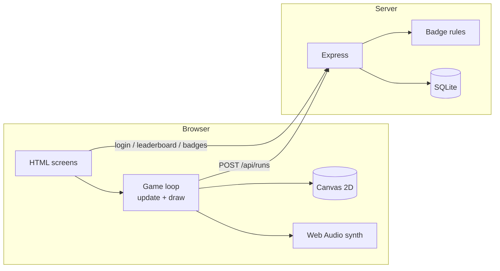
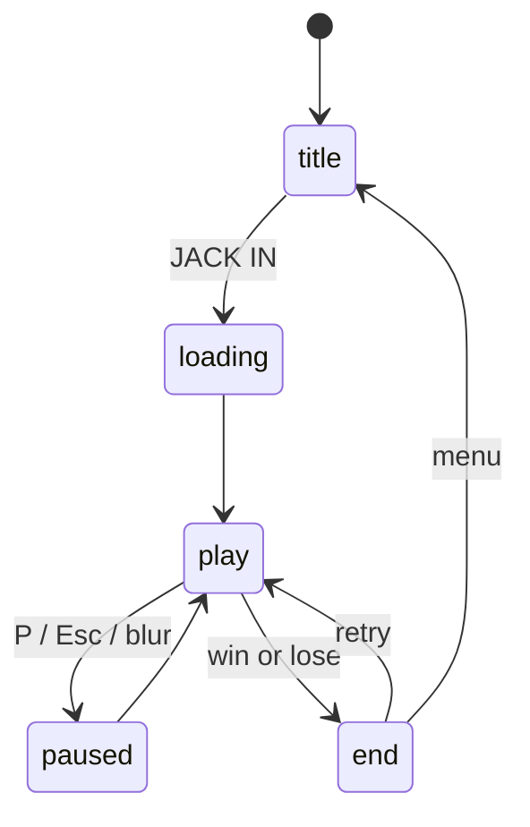

<div align="center">

```
███╗   ██╗███████╗ ██████╗ ███╗   ██╗██████╗ ███████╗
████╗  ██║██╔════╝██╔═══██╗████╗  ██║╚════██╗╚════██║
██╔██╗ ██║█████╗  ██║   ██║██╔██╗ ██║ █████╔╝    ██╔╝
██║╚██╗██║██╔══╝  ██║   ██║██║╚██╗██║██╔═══╝    ██╔╝
██║ ╚████║███████╗╚██████╔╝██║ ╚████║███████╗   ██║
╚═╝  ╚═══╝╚══════╝ ╚═════╝ ╚═╝  ╚═══╝╚══════╝   ╚═╝
                  A  F  T  E  R     D  A  R  K
```

### The city never sleeps. The Sentinel never blinks. **Run.**


**A neon-drenched cyberpunk arcade runner with a built-in synthwave soundtrack,
a time-bending Overdrive mode, real accounts, a global leaderboard, and collectible win badges.**

[Quick Start](#-quick-start) · [Gameplay](#-gameplay) · [Neon Overdrive](#-neon-overdrive) · [Architecture](#-architecture) · [API](#-api-reference) · [Deploy](#-deployment)

</div>

---

## ⚡ The Pitch

You are a runner in District 27. An AI security system called **SENTINEL** has locked onto your signal.
Dash through a rain-soaked megacity, smash hunter drones, grab energy shards, and when the meter fills,
**tear time apart**.

Everything you see and hear is generated in code: skyline, rain, reflections, holograms, glitch
effects, and the music. There are no image files and no audio files.

## 🎮 Gameplay

| | |
|---|---|
| **Goal** | Survive the full level and reach the **EXIT GRID** |
| **Health** | 3 hit points, with a shield power-up as a buffer |
| **Hazards** | Pits, barrier blocks (jump), laser gates (slide), hunter drones (dodge or destroy) |
| **Drones** | Patrol on a sine wave, then **lock on and chase** inside ~520px |
| **Chase sequence** | At 66% progress the SENTINEL wall starts closing in. Shards push it back, hits let it gain |
| **Combo** | Chain pickups and kills for up to **x8** score multiplier |
| **Difficulty** | Speed, hazard density and drone count all scale with distance |
| **Secrets** | 3 hidden **data chips** on high platforms, worth 500 points each |

### Power-ups
| Icon | Name | Effect | Duration |
|---|---|---|---|
| ⏱ | **Slow-Mo** | World runs at 55% speed | 5 s |
| ◈ | **Shield** | Absorbs one hit | 14 s |
| » | **Boost** | +40% run speed | 4.5 s |

### Controls
| Action | Keyboard | Touch |
|---|---|---|
| Jump / double jump | `Space` `W` `↑` | JUMP |
| Slide / fast-fall | `S` `↓` | SLIDE |
| Dash (breaks hazards, invulnerable) | `Shift` `X` | DASH |
| **Neon Overdrive** | `E` `F` | OVERDRIVE |
| Pause | `P` `Esc` | ❚❚ |
| Mute | `M` | 🔊 |

Touch buttons appear automatically on touch devices.

## 🌀 NEON OVERDRIVE

Shards and drone kills fill the meter. At 100%, hit **E** and the whole game changes:

- 🕒 **Time slows** to 55% while *you* get **2.5x speed**, so you feel fast and the world feels frozen
- 🎨 The palette rotates into hyper-saturated neon, with pulsing screen tint and speed lines
- 💥 A triple **shockwave** vaporizes every drone nearby
- ✨ Rainbow **light trails** follow the runner
- 🔦 Hazards and enemies get **white-hot outlines**
- 🧲 Shards are **magnetized** toward you, and you are invulnerable and smash through obstacles
- 🔊 The synth tempo jumps from 104 to 142 BPM and the filters open up

## 🏅 Accounts, Badges & Leaderboard

Register a **Runner ID** to save every run. **Every win earns a badge**: an `ESCAPE #n` stamp, plus
special ones:

| Badge | How to earn it |
|---|---|
| 🏁 First Escape | Win for the first time |
| 💎 Flawless | Win without taking damage |
| ⚡ Speed Demon | Win in under 60 seconds |
| 🌀 Overdriver | Win using Overdrive 2+ times |
| 🎯 Drone Slayer | Destroy 10 drones in one run |
| 🗝️ Data Thief | Find all 3 hidden chips in one run |
| 🛡️ Veteran | 5 total wins |
| 👑 Legend | 10 total wins |

**Skins** unlock locally: `VOLT` (default), `VIPER` (win once), `AURUM` (find 3 chips total), `GHOST` (score 5000).

## 🧠 Tech Stack

| Layer | Tech |
|---|---|
| Rendering | HTML5 Canvas 2D, offscreen parallax tiles, additive blending |
| Audio | Web Audio API (oscillators, filters, noise buffers, lookahead scheduler) |
| Front-end tooling | Vite 5, vanilla ES modules, zero runtime dependencies |
| Back end | Node.js, Express 4 (serverless on Vercel) |
| Database | SQLite via `@libsql/client` (local file in dev, Turso in production) |
| Auth | bcrypt password hashing, JWT sessions (30 days) |
| Hardening | Rate limiting, input validation, run sanity checks, parameterized SQL |

## 🏗 Architecture



**Game states**



**Engine notes**
- Game loop on `requestAnimationFrame` with delta time capped at 50 ms
- Hand-written physics: gravity, variable jump height, double jump, jump buffering, one-way platforms
- AABB collision for hazards, radius checks for pickups and drones
- Procedural level generation 1700 px ahead of the player, with off-screen entities culled
- Parallax city pre-rendered once per layer, then scrolled
- Wet-street reflections come from re-drawing the world flipped and clipped
- Glitch transitions copy random canvas slices back onto themselves
- Music uses a 40 ms timer that schedules notes ~150 ms ahead on the audio clock for tight timing

## 🚀 Quick Start

**Requirements:** [Node.js](https://nodejs.org) 18 or newer

```bash
npm install
npm run dev
```

Open **http://localhost:5173**. The command starts the API on port 3001 and the game together.

> ⚠️ Don't open `index.html` directly or through VS Code Live Server. The game must run through Vite.

| Script | What it does |
|---|---|
| `npm run dev` | API + Vite dev server with hot reload |
| `npm run server` | API only |
| `npm run build` | Production build to `dist/` |
| `npm start` | Build, then serve game + API on one port |

## ☁️ Deployment (Vercel)

Vercel runs the game as static files and the API as serverless functions (`api/index.js`). Serverless
functions have no permanent disk, so production uses **Turso** (hosted SQLite, free tier). Locally the same code uses a plain file.

1. **Create the database:** sign up at [turso.tech](https://turso.tech), create a database, copy its **URL** (`libsql://...`) and generate an **auth token**
2. **Push the project to GitHub**
3. **Import the repo** at [vercel.com/new](https://vercel.com/new). Vercel detects Vite automatically (build `npm run build`, output `dist`)
4. **Add environment variables** (Project Settings, then Environment Variables):

| Name | Value |
|---|---|
| `JWT_SECRET` | a long random string |
| `TURSO_DATABASE_URL` | `libsql://your-db...turso.io` |
| `TURSO_AUTH_TOKEN` | your Turso token |

5. **Deploy.** Tables are created automatically on the first request.

Other Node hosts (Render, Railway, a VPS) also work: run `npm start` and set the same variables.

> The login rate limiter keeps its counters in memory, so on serverless it is only best-effort. Use a shared store such as Redis for strict limits.

## 📡 API Reference

| Method | Route | Auth | Description |
|---|---|---|---|
| `POST` | `/api/register` | none | `{username, password}`, returns `{token, user}` |
| `POST` | `/api/login` | none | `{username, password}`, returns `{token, user}` |
| `GET` | `/api/me` | Bearer | Profile and earned badges |
| `POST` | `/api/runs` | Bearer | Submit a finished run, returns `{user, newBadges}` |
| `GET` | `/api/leaderboard` | none | Top 10 by best score |
| `GET` | `/api/badges` | none | Badge catalogue |

Usernames are 3-16 characters (`A-Z a-z 0-9 _`), and passwords are 8-72 characters.

## 📁 Project Structure

```
neon27/
├── index.html          screens and markup
├── src/
│   ├── main.js         engine, rendering, audio, account UI
│   └── styles.css      HUD, glitch animations, menus
├── server/
│   ├── app.js          routes, auth, validation (shared by local + Vercel)
│   ├── index.js        local server entry
│   ├── db.js           database client, schema, secret handling
│   └── badges.js       badge rules
├── api/index.js        Vercel serverless entry
├── vercel.json         routes /api/* to the function
├── public/             static assets
├── vite.config.js      dev proxy /api to :3001
└── .env.example
```

## 🔒 Security & Known Limitations

- Passwords are bcrypt-hashed, SQL is parameterized, and login and register are rate limited
- Scores come from the browser, so the server rejects impossible values (for example, a win under 20 s)
  but can't prove a score is genuine. Fully trusted scores would need server-side run replay
- Local progress (skins, local best) lives in `localStorage` and can be edited by the player

## 🗺 Roadmap

- [ ] Split `main.js` into modules (audio, physics, render, ui) and add unit tests
- [ ] Fixed-timestep simulation for deterministic replays
- [ ] Multiple levels and a boss encounter
- [ ] Daily challenge seed and weekly leaderboard
- [ ] Server-side run validation
- [ ] Gamepad support

## 📜 License

MIT. See [LICENSE](LICENSE).

<div align="center">

**Built in District 27. Stay neon.** ⚡

</div>
